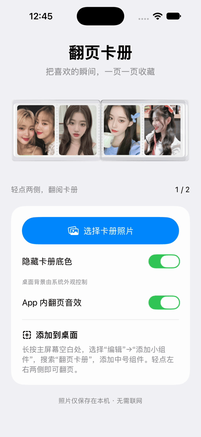

# 翻页卡册 · FlipCardAlbum

原生 SwiftUI 相册与 WidgetKit 桌面小组件。离线保存照片，通过左右页按钮翻阅卡册，使用透明塑料书页、反光和书脊折叠效果。

## 当前状态

这是按用户要求先上传的开发版本。真机 iPhone 11 / iOS 18.7.8 已确认隐藏卡册底色时的双向翻页；用户反馈显示底色时存在桌面不更新、触控失效及选图后不刷新的问题，仍在复现和修复。当前代码已将桌面静态底板移到 WidgetKit containerBackground，完整回归尚待完成，不标记为全部修复。

## 真机桌面翻页 GIF

以下为已验收的隐藏卡册底色状态，原速截取真机中号组件的双向翻页；不包含个人桌面图标或通知。


## 透明背景方案

“隐藏卡册底色”不能直接穿透系统底板。空白桌面截图贴合功能按用户要求暂缓，裁剪、位置对齐、共享存储及测试要求已记录在 [透明背景实现方案](docs/TRANSPARENT-BACKGROUND.md)。

## 开发

- iOS 17 及以上，iPhone / iPad。
- 使用 Xcode 打开 `FlipCardAlbum.xcodeproj`，选择 `FlipCardAlbum` scheme。
- 项目无第三方运行时依赖。`project.yml` 可通过 XcodeGen 重新生成工程。
- 模拟器使用本地 ad-hoc 签名以保留 App Group 权限。真机运行时配置自己的开发团队，并为 App 和 Widget 扩展配置相同的 App Group：`group.com.lpkiki.FlipCardAlbum`。

```sh
xcodegen generate
sh scripts/test-simulator.sh YOUR_BOOTED_SIMULATOR_UDID
```

测试脚本先构建、显式安装 App，再校验已安装扩展与构建产物的哈希，避免对旧版桌面组件误测。

## 使用

打开 App 导入照片；长按主屏幕空白处，添加「翻页卡册」中号小组件。轻点左半页或右半页翻阅。「隐藏卡册底色」仅移除渐变底板，塑料书页保留透明纹理。iOS 主屏幕的容器底色由系统外观决定，在默认外观下仍可能显示白底，不等同于 Android 的壁纸穿透。

内置示例包含两页，首次显示原版参考的 5–8 号图片。自选照片按四张组成一页，不满一页循环填充；照片只存在本机共享容器中。翻页音效仅在 App 内播放，桌面组件不播放后台音频。

## App 内翻页实录

以下动图来自 iOS 模拟器的 App 内实际点击录像，已逐帧确认双向收拢、展开。它不代表桌面 Widget 动画已验收。



## 还原依据

参考 iScreen Android 3.0.40 的翻页卡册资源和布局。中号原画布为 329 × 155；书页围绕中心书脊做水平收拢、展开。APK 动画 XML 表示两段各 500 毫秒，实际 iOS 桌面效果需要由 WidgetKit 宿主验证，不能用 App 内预览代替。

参考资源出处见 [资源说明](docs/ASSETS.md)。本仓库用于私有还原研究；不包含原 APK、设备个人照片或账户数据。

### Android 原版参考录像

下面是原版真机录屏的裁剪片段，用于对照；不是 iOS 成品演示。


WidgetKit 数据更新动画的支持范围见 [Apple 官方说明](https://developer.apple.com/documentation/widgetkit/animating-data-updates-in-widgets-and-live-activities)。桌面小组件与 App 内预览分别验证和录制。
